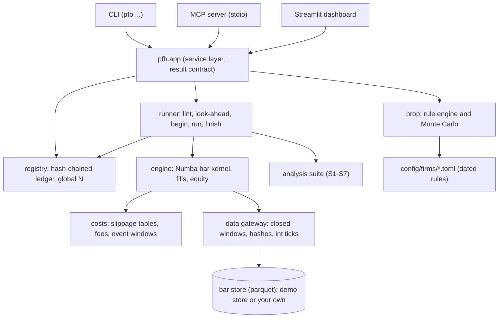
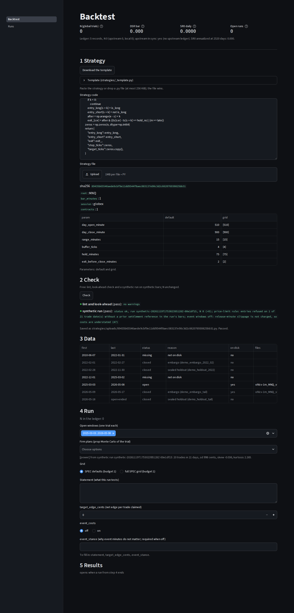
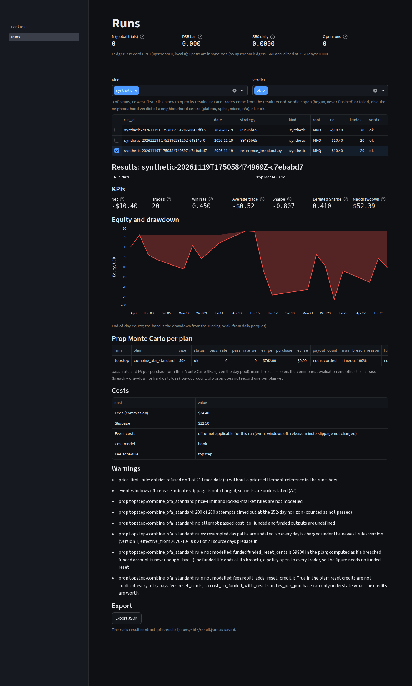
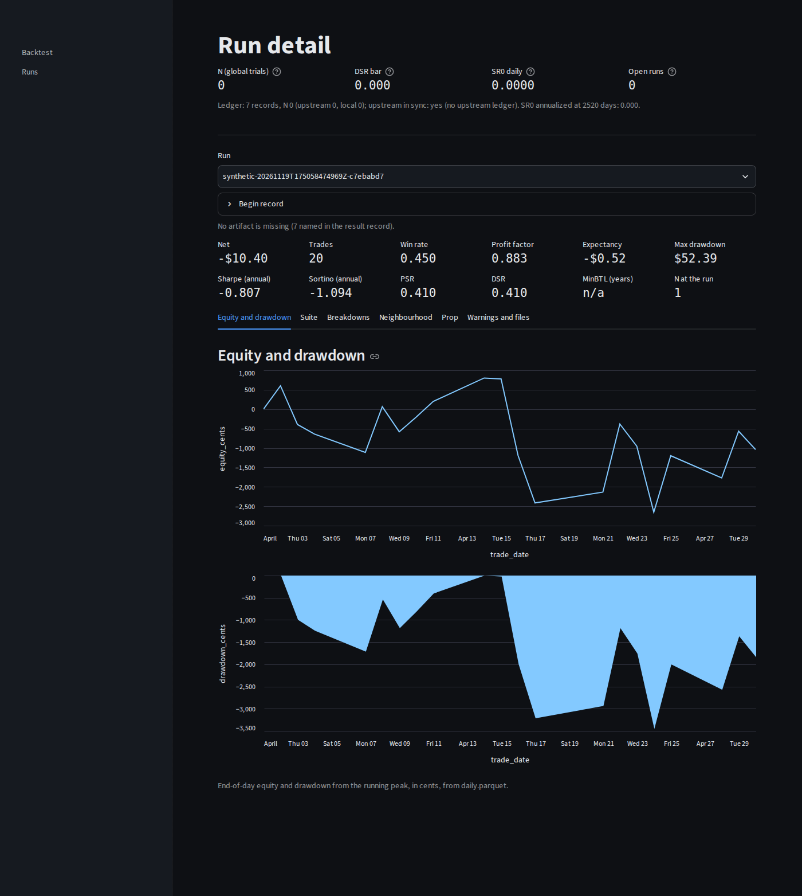
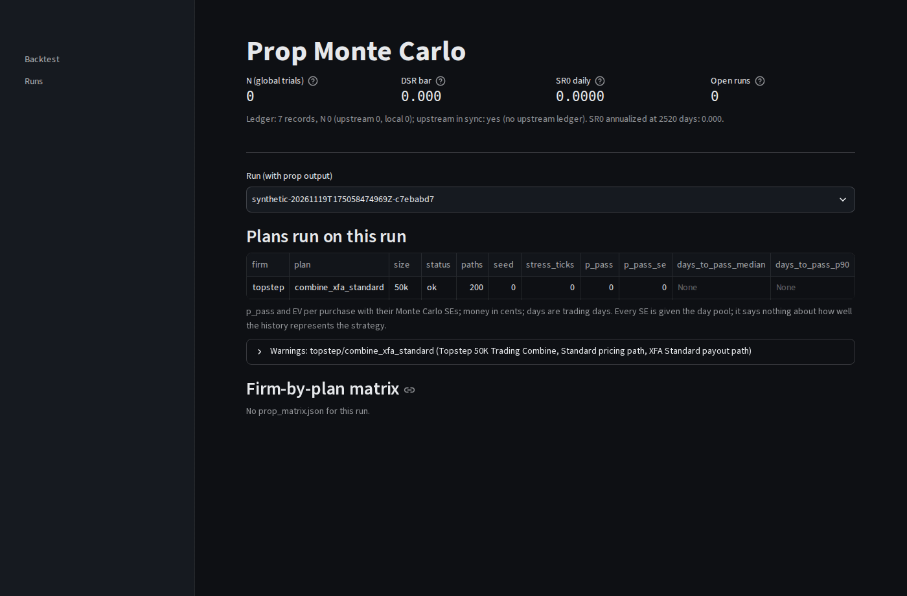

# PropFirmBacktester (pfb)

A laptop-scale backtester for intraday CME futures strategies that also prices the prop-firm side of a
strategy: the probability of passing an evaluation, days to pass, the cost of getting funded and the expected
value per account purchase, per firm and plan. It is built to be driven both by a person (a Streamlit
dashboard) and by an AI coding agent (one CLI command or MCP tool call that returns one JSON object).

The repository runs end to end on synthetic data: `uv run pfb demo` builds a small synthetic bar store and
exercises the whole pipeline in a few seconds. Real use needs your own licensed bar data (see Limitations).

## What it does

- **Global trial registry.** Every configuration evaluated on real data is a counted trial in an append-only,
  hash-chained ledger (`ledger/registry.jsonl`), so the program has one global trial count N. A trial needs a
  registered hypothesis file (strategy hash, roots, windows, parameter grid, budget, cost model, power inputs)
  committed before it runs; N rises before the engine starts, so a crashed run still counts.
- **Deflated statistics and power gates.** Every run reports the probabilistic and deflated Sharpe ratio (DSR
  deflated at the live N) and the minimum backtest length. A trial must state a minimum detectable edge before
  it runs (a power check at begin), and the result reports the realized power test after it.
- **Prop-firm Monte Carlo.** Day-path resampling of the strategy's own per-minute equity through a rule engine
  for 13 firm plans in `config/firms/` (five firms: bulenox, lucid, mffu, topstep, tradeify): trailing and
  end-of-day drawdowns, daily loss limits, consistency rules, payout gates, fees and resets. Outputs carry Monte
  Carlo standard errors, and a firm-by-plan EV matrix covers every plan.
- **Costs that include event windows.** Per-minute slippage tables plus per-firm commissions; fills inside a
  scheduled-release window pay an event cost from a pinned release calendar; cost stress (+1 and +2 ticks a
  side) on every run.
- **Look-ahead checks.** A static allowlist lint of the strategy file (numpy, polars and math only, no I/O), a
  truncation-invariance check on synthetic and real bars, and planted-future canaries that a leaky engine
  would fail.
- **Analysis suite.** Random-entry baselines, walk-forward folds, parameter-neighbourhood runs, breakdowns and a
  sizing table, all fixed by the hypothesis before any trial.
- **Three front ends, one service layer.** CLI (`pfb ...`), an MCP server (`python -m pfb.mcp`, stdio) and the
  dashboard all call `pfb.app`, so they return the same result contract (`docs/result.schema.json`).

## Architecture

The binding design is `docs/ADR-001_architecture.md`; the trial rules are `docs/TRIALS.md`; the prop Monte Carlo
is `docs/PROP_MC.md` with the rule schema in `docs/PROP_RULES_SCHEMA.md`; the analysis suite is
`docs/ANALYSIS_SUITE.md`.

## Quick start (synthetic data)

Requirements: Python 3.12 and [uv](https://docs.astral.sh/uv/).

    uv sync
    uv run pfb demo           # build the demo store, read it, check, run, prop MC; prints a summary and the run id
    uv run pfb demo --dash    # the same, then the dashboard on http://127.0.0.1:8501 (Ctrl-C stops it)

`pfb demo` builds a seeded synthetic bar store (MNQ and NQ, about 850k one-minute bars) into `data/demo/`
(git-ignored), reads it through the normal data gateway (an open range, then a range the closed-window table
refuses), runs `pfb check` on `strategies/reference_breakout.py`, one synthetic run with the analysis suite and a
prop Monte Carlo on one plan at a fixed seed. Synthetic runs are logged in the ledger and add nothing to N. To
return the ledger to its committed state afterwards: `git checkout ledger/registry.jsonl`.

Writing your own strategy:

    uv run pfb new my_orb                                        # strategies/my_orb.py from the template
    uv run pfb check strategies/my_orb.py                        # lint + look-ahead check; logs nothing
    uv run pfb run strategies/my_orb.py --kind synthetic --json  # one JSON object on stdout; N unchanged

AGENTS.md is the guide for contributors and AI coding agents (commands, the result contract, the trial rules).

## Screenshots (synthetic demo data)

The Backtest page: a strategy pasted, checked (lint, look-ahead, synthetic run) without touching N.

The Runs page: a run's KPIs, equity and drawdown, the prop Monte Carlo row, costs and every warning.

Run detail and the prop Monte Carlo page:

## Design choices

- **Integer ticks and cents.** Prices are int64 ticks per instrument and money is integer cents; time is UTC
  nanoseconds plus the CME trade date and the Chicago session clock. A float never carries money and never
  decides a rule boundary, so a drawdown floor or a daily loss limit cannot be crossed by rounding.
- **One global N.** Multiple testing is the main way a backtest lies. Every real-data configuration counts once,
  across all strategies and sessions, and the DSR is deflated at that N. Exact replays add nothing; a replay
  under changed code counts as new.
- **Closed windows.** Every bar read goes through one gateway that refuses rows inside the holdout and embargo
  windows of `config/closed_windows.toml` (pinned by sha256), by label and by timestamp, so a mislabelled row
  cannot slip through. Store files are hash-checked against their catalog pins.
- **Refusals as data.** A rule violation is not an exception trace: every entry point returns
  `{"status": "refused", "error": {"code", "reason"}}` (exit 2 on the CLI), so an agent can read why and act.
- **Fills that cannot flatter.** A signal at a bar's close fills at the next bar's open; a limit target needs a
  one-tick trade-through; a stop fills at the worse of the stop and the open; inside a bar the worst case is
  assumed; no position crosses a session or a roll.
- **Deterministic seeds.** Synthetic bars, the look-ahead check, baselines and the Monte Carlo are seeded; the
  seed is in every record, and a trial runs at the seed its hypothesis states.
- **Rules in config, not code.** Firm rules live in dated TOML files with the date they were read and the date
  they took effect; a plan's sha256 goes into each prop record.

## Limitations

- **Synthetic demo only.** The repository ships no market data. The demo store, cost tables
  (`config/demo/`) and release calendar are fictional values generated in code; results on them say nothing
  about any market. Real use needs your own licensed one-minute bar data in the store layout the gateway reads
  (`config/paths.example.toml` is the template for `config/paths.toml`).
- **Firm rules change.** The configs in `config/firms/` are dated snapshots and will go stale; check each firm's
  current terms before relying on a figure. Some rules the firms do not publish are assumed, and the run says so
  in its warnings.
- **Model limits.** No order-book simulation: costs are per-minute averages, event costs cover only calendar
  releases, and stops in fast markets are optimistic. The prop Monte Carlo resamples the strategy's own days,
  so its standard errors say nothing about whether that history represents the future.
- **Not investment advice.** This is research software. Nothing here claims or implies that any strategy is
  profitable, and no performance figure from real data is published.

## Development

    uv run ruff check .
    uv run pyright
    uv run pytest -q

CI (`.github/workflows/ci.yml`) runs the same three on every push and pull request.

## License

See LICENSE.
